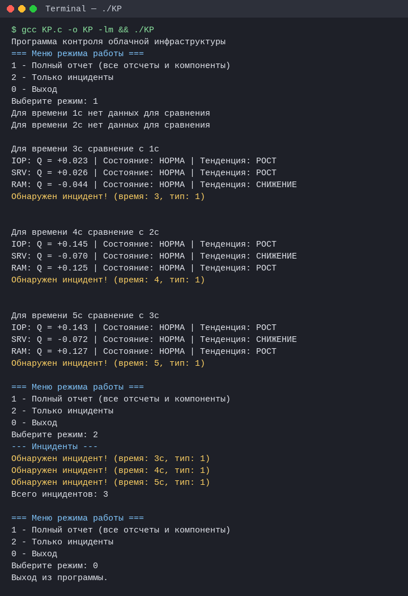

# Курсовой проект: Программа контроля облачной инфраструктуры

** бОТИ-261 Гуров Е.А. ** Вариант 11  
**Этап:** КТ2 — Структура программы (функции расчёта и контроля, обработка ошибок, меню)

---

## 1. Назначение программы
Программа контролирует работу облачной инфраструктуры по трём показателям (`IOP`, `SRV`, `RAM`), считает их относительное изменение во времени и находит инциденты.

---

## 2. Индивидуальный вариант (Вариант 11)

* **Компоненты:** `IOP`, `SRV`, `RAM`
* **Шаг сравнения:** $k = 2$
* **Порог тревоги:** $L = 2.0$
* **Формула показателя $Q$:**
  $$Q[i] = \frac{X[i] - X[i-k]}{X[i-k]}$$
* **Правило состояния:** если $|Q| > L$ — «ТРЕВОГА», иначе «НОРМА». Если $Q > 0$ — рост, если $Q < 0$ — снижение.
* **Логическая формула инцидента («Противоположные тенденции»):**  
  Инцидент возникает, когда одновременно один компонент растёт ($Q > 0$), а другой падает ($Q < 0$), если расчёт прошёл без ошибок ($err = 0$):
  $$q\_up = (trend_{IOP} == 1) \lor (trend_{SRV} == 1) \lor (trend_{RAM} == 1)$$
  $$q\_fall = (trend_{IOP} == -1) \lor (trend_{SRV} == -1) \lor (trend_{RAM} == -1)$$
  $$Incident = q\_up \land q\_fall$$

---

## 3. Структура программы

Программа разделена на отдельные функции (объявления сверху, реализация под `main`):
* `calc_Q` — расчёт $Q$ по паре `X[i]` и `X[i-k]`.
* `check_Q_error` — проверка деления на ноль и некорректных значений (`isnan`, `isinf`).
* `check_Q` — проверка превышения порога $L$ («ТРЕВОГА» / «НОРМА»).
* `get_trend` — определение направления (`1` рост, `-1` снижение, `0` без изменений или ошибка).
* `check_incident` — проверка инцидента по логической формуле `q_up && q_fall`.
* `print_component_result` — вывод результата по одному компоненту.

В `main` добавлено меню выбора режима работы (`1` — полный отчёт, `2` — только инциденты, `0` — выход).

---

## 4. Тестовые данные (из карточки задания)
* `IOP`: `43.7, 44.2, 44.7, 50.6, 51.1`
* `SRV`: `53.8, 57.2, 55.2, 53.2, 51.2`
* `RAM`: `32.0, 31.3, 30.6, 35.2, 34.5`

---

## 5. Ручной расчёт

Так как $k = 2$, первые два отсчёта ($t = 1, 2$) пропускаются:

1. **Время 3с (сравниваем с 1с):**  
   `IOP`: $(44.7 - 43.7) / 43.7 = +0.023$ (норма, рост)  
   `SRV`: $(55.2 - 53.8) / 53.8 = +0.026$ (норма, рост)  
   `RAM`: $(30.6 - 32.0) / 32.0 = -0.044$ (норма, снижение)  
   **Инцидент есть** (IOP и SRV растут, RAM падает).

2. **Время 4с (сравниваем с 2с):**  
   `IOP`: $(50.6 - 44.2) / 44.2 = +0.145$ (норма, рост)  
   `SRV`: $(53.2 - 57.2) / 57.2 = -0.070$ (норма, снижение)  
   `RAM`: $(35.2 - 31.3) / 31.3 = +0.125$ (норма, рост)  
   **Инцидент есть** (IOP и RAM растут, SRV падает).

3. **Время 5с (сравниваем с 3с):**  
   `IOP`: $(51.1 - 44.7) / 44.7 = +0.143$ (норма, рост)  
   `SRV`: $(51.2 - 55.2) / 55.2 = -0.072$ (норма, снижение)  
   `RAM`: $(34.5 - 30.6) / 30.6 = +0.127$ (норма, рост)  
   **Инцидент есть** (IOP и RAM растут, SRV падает).

---

## 6. Скриншот работы программы и сравнение с расчётом

Вывод программы полностью совпал с ручным расчётом: первые $k = 2$ шага пропущены, значения $Q$ совпали до тысячных, инциденты найдены на `3с`, `4с` и `5с`.
